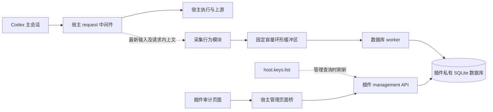

# 总体设计

## 1. 方案与职责

通过独立的 Codex Proxy RS 网关插件实现 Prompt 审计。插件负责采集、存储、共享审计时区与排除规则、查询语义，通过宿主已有的中间件和管理页桥接入。插件在 `request` 中间件提取最新用户输入及本次请求自带的有限上文，提交到固定容量环形缓冲区，由独立 worker 将审计事实写入私有 SQLite 数据库，并通过 `management` 能力提供管理员页面。

审计单位是满足采集规则的最后一条用户输入。插件依据[采集行为](collection.md)检查请求的最后一个输入项；以工具调用、工具结果或 assistant 消息结束的请求不产生记录。重复请求分别形成审计记录，模型调用随后失败、取消或未发送也可能留下记录。

| 模块 | 负责的事实与接口 |
| --- | --- |
| 中间件适配 | 解析 HTTP / WebSocket 请求，非阻塞提交审计任务后继续调用宿主链 |
| 采集行为 | 统一应用内建来源与自定义 UA 排除规则、检查最新用户输入、选择本次请求的有限前序上下文 |
| Key 名称查询 | 管理查询分页读取宿主当前 Key 列表，以临时 ID 到名称映射展示记录；不保存名称或目录 |
| 审计任务与存储 | 环形缓冲区满时覆盖最旧任务；worker 以有界批次保存输入及固定上下文；Store 封装数据库连接、SQL、事务、类型转换和错误分类 |
| 管理 API 与页面 | 使用已有管理员身份，提供筛选、列表与详情；点击加载请求信息后单独查询宿主，不重新解释采集规则 |

首期面向 Codex 经 Responses HTTP / WebSocket 进入网关的文本对话。其他客户端缺少 Codex 元数据时，只能按实际可见的用户消息形成观察记录，不能确认其来源。本方案不提供真人身份认证、完整 Agent 运行回放或对子代理执行过程的审计。

## 2. 已核实的插件合同

本文区分“宿主已经提供的能力”与“本插件采用的设计”。以下固定源码是合同依据，不表示插件已经完成安装或运行验证。

| 来源 | 核实基线 | 用途 |
| --- | --- | --- |
| Codex Proxy RS upstream（zyycn/codex-proxy-rs） | `v3.28.0`，`447869860a0fb88f78109cdb700db0cb1eb5d8b5` | 宿主与 SDK 合同的固定源码基线 |
| 官方 Codex | `0.160.1`，`d27764b82f7118f674371e6d6e76271d9d606edb` | 输入结构、子代理来源、增量请求及 turn 行为 |
| codex-proxy-plugins | `cfd37537f99f2c957639c6fa2c14d40dcb0c3368` | 独立插件组织方式与管理页面示例 |

宿主兼容声明为 `~3.28.0`，接受稳定版 `>=3.28.0, <3.29.0`。目标宿主合同为 manifest v2、进程协议 v2、middleware v4 和 management v1。插件使用 upstream 仓库的 Rust `gateway-plugin-sdk`，Git 依赖固定到上表宿主提交。SDK 当前标记为 `0.1.0`，不能仅凭这个版本号表达兼容性。[宿主兼容表][host-compat]、[SDK 清单][sdk-cargo]

中间件调用的 `timeout_ms` 限制插件自身处理时间，默认上限为 120 秒。宿主与 SDK 在 `next.run` 等待宿主期间暂停这份预算，结果或错误返回后恢复剩余时间；入站与返回处理共享同一预算，普通宿主回调仍计时。请求总期限、下游操作超时与取消信号独立生效，客户端取消或插件退出仍会结束等待并回收资源。本插件使用上述 SDK 构建，以同时满足宿主与插件侧的等待语义。[中间件预算][middleware-budget]

用户提供的 [workbench 示例][workbench] 可以作为工程入口参考，但它使用 middleware v3 及较早的 SDK Git revision。新插件使用 v4 时，应同时选择支持 v4 的 SDK，不能只修改 manifest 的能力版本。

本插件只需要 `middleware` 和 `management` 两项能力。安装时必须把 middleware 绑定到 `request` 阶段，并安排在其他会改写输入的 request 插件之前；清单声明能力本身不会启用采集。management 自动激活，不接受额外 binding。[能力合同][capabilities]、[绑定校验][binding]

插件是受信任的独立进程，可以自行访问数据库。宿主回调不需要额外权限声明；`HostClient::dispatch_http` 使用宿主签发的插件身份调用管理接口，不依赖管理员 Cookie，期限、取消与资源生命周期仍生效。宿主没有提供任意 SQL、数据库连接池借用或宿主 Vue 组件注入接口；存储与页面分别按下文的私有 SQLite 和管理页面合同实现。[信任边界][manifest]、[主动 HTTP 分派][http-dispatch]

## 3. Client Key 与审计身份

request 中间件提供 `client_key_id`，每条审计记录只保存稳定的 Key ID，不保存名称或名称观测时间。采集不请求宿主 Key 列表。列表、详情与 Key 筛选查询分别通过 `host.keys.list` 分页取得宿主当前 `{id, name, enabled}` 及 `next_cursor`，为该次响应建立临时 ID 到名称映射，不持久化目录。该接口没有按 ID 查询名称的专用入口，名称查询必须读取完整分页。[Key 列表类型][keys]

旧记录和新记录使用同一查询时名称；Key 改名后，后续查询立即显示新名称。宿主已经删除或未返回的 Key 在审计记录中显示“名称未知”，其记录仍按稳定 ID 保留和筛选。名称超过页面可表示的 512 码点或为空时返回 `null`。宿主列表读取失败、分页不完整或超过读取预算时，相关查询返回 `503 unavailable`，不把失败解释成所有 Key 已删除。每次名称读取最多等待 5 秒、接受 100,000 个 Key；重复 ID 或循环游标视为无效列表。服务端当天日期、共享时区保存与正文分段查询不读取 Key 列表。

Client Key 代表网关凭据的归属。多人共享一个 Key 时，插件不能进一步确认究竟是哪一个人发言；本设计不额外构造用户身份。Key 明文不进入审计存储。

## 4. 插件私有 SQLite 的存储设计

### 4.1 插件私有数据库

插件面向单宿主、单插件实例，使用 SQLx 的 SQLite 驱动在进程内读写私有数据库文件。SQLite 3.54.0 引擎随插件静态链接，其版本由构建依赖锁定，无需独立数据库服务。插件自建连接池、自管 schema 初始化和数据生命周期，不读取宿主 Key 表、不修改宿主迁移记录、不设置指向宿主表的级联外键。Key 名称通过 SDK 获取。[SQLite 驱动][sqlite-driver]

宿主的 `host.state` 已使用宿主 PG，但它是插件实例私有的 JSON KV，不是通用数据库协议。其公共能力与持续审计的需求有明显区别：

| `host.state` 合同 | 对本设计的影响 |
| --- | --- |
| 只提供 `get`、`put`、`delete`，没有列举、SQL 或跨记录事务接口 | 不适合按 Key、时间、会话分页检索持续增长的审计记录 |
| 每 namespace 最多 10,000 条、总计 16 MiB、单值 256 KiB | 不作为审计正文仓库 |
| `put` 无 expected version 时只创建；更新和删除使用版本号 | 它的 CAS 不能等同于数据库事务接口 |
| 状态绑定插件实例，删除实例会级联删除私有状态 | 审计留存不依附插件安装生命周期 |

这些约束来自 [状态 API][state-api]、[配额声明][state-limits]及[宿主状态表关系][state-schema]。workbench 的私有状态用法可供参考，但不构成审计日志的存储协议。

审计记录固定保留 3 天，即从 `first_observed_at` 起经过 72 小时，不提供保留期配置。清理使用插件当前 UTC 时间，删除严格早于 `now - 72 hours` 的记录；恰好位于边界的记录留到下一批，展示时区和夏令时不影响保留期。删除审计行时，数据库通过 `ON DELETE CASCADE` 在同一事务删除它的输入和前序对话；共享时区、排除规则与游标签名密钥不属于这次清理范围。

插件在启动成功后立即启动独立清理任务，无请求时也每天清理。每批按记录时间、ID 从旧到新最多删除 1,000 条，复用时间索引，并在写事务中完成删除；满批提交后等待 100 毫秒继续清理积压，未满批时等待 24 小时开始下一轮。计数只包含审计行，不包含级联删除的正文行。各批独立提交，清理 SQL 的执行时限为 3 秒，沿用 1 秒锁等待上限，任务每批总等待上限为 4 秒；Store 负责执行时限、中断与事务回滚，普通 SQL 的执行时限仍为 1.5 秒。失败记录日志，在下一轮每日清理时重试。清理不进入请求路径或占用写入 worker，退出时停止。允许到期后再保留约一天，因此正常运行时实际留存约 3～4 天；锁竞争、积压、插件停用或数据库不可用会延长这个间隔，恢复运行后继续清理已有过期记录。删除插件实例或 Client Key 本身不触发清理。

SQLite 删除后的页空间可供数据库复用，数据库文件通常不会立即缩小；插件不增加自动压缩任务。这是按时间清理历史的策略，不是磁盘字节配额，仍需为约 3～4 天的数据、清理积压和 WAL 文件预留空间。[页空间复用][sqlite-space]

### 4.2 数据目录与存储边界

宿主以临时解包目录 `<runtime_data_dir>/plugins/plugin-*` 作为插件启动目录；包对象释放时该目录会被清理，重新解包时路径也会改变。Store 以启动目录向上两级定位宿主持久数据根目录，自动创建固定文件 `<runtime_data_dir>/huwei.prompt-audit/audit.sqlite3`，重启和重新解包复用同一文件。插件 configuration 为 `{}`，无 secrets、目录配置或额外握手字段。[进程启动目录][process-env]、[临时解包目录][package-cache]、[缓存位置][plugin-cache]

Store 初始化目录、连接池和初始 schema，事务内创建 `audits`、`contents`、`settings` 并记录 schema 版本。连接启用 WAL、`synchronous=FULL`、外键检查和 1 秒锁等待上限。SQLite 同时只允许一个写事务；现有采集 worker、独立清理任务、时区与排除设置保存共用 Store，由 SQLite 协调写事务，管理查询使用读事务。[WAL][sqlite-wal]、[连接设置][sqlite-pragmas]

Store 对外提供批量保存、过期清理、设置存取、列表、详情、正文及来源请求引用读取，返回普通 Rust 数据类型和存储错误，不暴露 SQLx 连接、Row 或驱动错误。列表的准确总数与候选记录在同一读事务中取得；详情的审计字段与有序正文描述也在同一读事务中取得。QueryService 继续负责参数解析、日期边界、游标签名、正文分段、响应大小限制和响应组装。宿主请求信息通过 §2 的 SDK 主动 HTTP 分派读取，完成来源请求引用的数据库读取后再调用宿主。

### 4.3 逻辑数据模型

数据库保存独立审计事实、共享时区与排除规则、游标签名密钥；采集不维护跨请求会话状态。以下是逻辑模型。

| 对象 | 主要数据 | 语义 |
| --- | --- | --- |
| 审计输入 | 审计 ID、Key ID、本次请求的记录时间、来源 request ID、各自独立的 thread ID 与 session ID、消息级 turn ID、输入内容及逐块类型 | 对最新用户输入的固定观察记录；重复请求分别保存，记录时间不等于客户端提交时刻 |
| 仓库快照 | 来源请求报告的仓库根路径及各 remote 名称、URL | 属于该 request ID 的观察，不反推为历史输入编写时的仓库状态 |
| 宿主请求关联 | 点击加载请求信息后，用已保存的来源 request ID 与 Key ID 读取宿主已有的 UA、请求模型、reasoning effort | 单独查询时组合，不在审计数据库中重复保存这三项 |
| 前序上下文快照 | 来自本次请求的有序消息；每条包含角色、文本、可用的 phase、截断标记 | 与输入一起保存，后续 Agent 输出不修改该快照 |

输入与其上下文组成同一个审计事实，在同一事务保存，落库后以自身内容供 UI 查询。环形队列、worker 批次、超时及丢失边界见[采集行为 §7](collection.md#7-审计任务与异步写入)。内容以有序文本块保存；非文本输入的范围见[采集行为](collection.md#4-识别用户输入)。

扩展元数据只保存上表的仓库根路径、remote URLs、消息级 turn ID 和逐块输入类型，取值与排除范围由[采集行为 §3.1](collection.md#31-解析元数据)定义。请求用途与来源只参与当次采集判定，不作为审计字段保存。请求缺少的上文不通过响应 ID、前驱关联或其他请求恢复。

管理员显式加载请求信息时，后端按审计 ID 读取已保存的来源 request ID 与 Key ID，通过 `HostClient::dispatch_http` 发起 `GET /api/admin/usage/records/detail?id=<requestId>`。客户端不提供宿主 request ID 或 Key ID。后端解析宿主详情响应，核对 `requestId` 与 `clientApiKeyId` 均匹配已保存值，再提取 `userAgent`、`requestedModel` 与 `reasoningEffort`。[宿主详情接口][host-request-detail]、[详情参数][host-request-query]、[宿主字段映射][host-request-fields] 插件的 `model` 来自 `requestedModel`，UA 是宿主记录的入站 UA；它们描述承载本次观察的模型请求，不能当作每条历史输入最初使用的模型或客户端。普通详情与正文读取不发起宿主请求详情查询。

来源请求可能尚未建档、未形成记录，或已经按宿主保留期清理；没有匹配的宿主记录时，独立请求信息接口返回 `requestMetadata: null`，不删除或隐藏审计输入。已存在记录中的未知字段逐项返回 `null`。宿主查询失败按接口错误返回，不能冒充缺失，页面在请求信息区域提供重试。宿主清理后不从审计副本恢复这三项，也不设置宿主表外键阻止清理；审计输入按 §4.1 的 72 小时保留期独立清理。[宿主清理][request-retention]

每次满足采集条件的请求形成独立审计记录，不按会话标识、turn ID、消息 ID 或正文合并；数据库没有输入去重唯一约束。

列表按 `(first_observed_at, audit_id)` 排序并使用稳定游标，建立支持时间、Key 和用户输入正文关键词检索的查询投影与索引。列表读取有限预览或命中片段；完整正文和上下文通过详情接口读取。搜索只针对用户输入文本，不搜索前序对话，也不生成二次模型摘要。

正文和结构化元数据使用 JSON 文本保存，保留包括 U+0000 在内的 Unicode 文本；记录时间使用 UTC 毫秒整数，设置值使用 BLOB，布尔值使用整数。搜索投影按每个码点编码为固定七字符 token，ASCII 大写字母只在匹配投影中转小写。这使字面子串匹配和有限预览能够在 SQL 中执行，既不使用数据库区域性的大小写转换，也不让 NUL 导致整条输入无法持久化。时间／Key 索引支持范围查询；MVP 正文子串检索扫描筛选范围内的投影，不承诺大规模全文索引性能。

### 4.4 与宿主数据库管理的关系

宿主的 PostgreSQL 与插件的 SQLite 分别管理各自的数据，宿主数据库迁移和请求记录清理不操作审计文件。插件数据目录随宿主持久数据区保留，但宿主 PostgreSQL 的 `pg_dump` 不包含 SQLite 文件。[备份实现][backup]

审计的 72 小时保留期作用于在线数据库，备份文件中的历史数据由备份保留策略管理。

## 5. 审计管理页面

### 5.1 接入方式

前端使用 Vue 3 和官方 [`@codex-proxy/ui` v0.3.2](https://github.com/zyycn/codex-proxy-ui/tree/v0.3.2)，按 [#278](https://github.com/zyycn/codex-proxy-rs/issues/278) 推荐的插件示例组织页面。表格、输入框、选择器和按钮直接使用组件库，加载其完整样式和主题变量；页面 CSS 负责审计布局与正文排版。Demo 的模拟宿主提供默认蓝色主题及浅色、深色切换；插件页面只消费宿主主题，以紧凑表格保留信息密度。

插件通过 `ManagementRegistration` 注册页面、静态资源和管理 API，在宿主侧边栏提供独立“Prompt 审计”入口。页面运行于隔离 iframe，通过 `window.codexProxyPlugin.request` 调用本插件已注册的路由。页面标题和简介由 `ManagementPage` 提供。[管理类型][management-types]、[页面桥合同][management-contract]、[侧边栏入口][sidebar]

管理路由使用宿主已有的管理员认证，页面资源声明 `public: false`，不注册公开 callback。插件无需新增登录体系。首期授权范围是宿主管理员查看已采集记录，没有按 Key 划分的终端用户门户。[管理员入口][admin-auth]

这个合同允许新增插件页面，不支持向宿主现有 Key 页或请求记录页直接插入列、标签页或组件。若以后需要此类嵌入交互，应单独调整宿主扩展合同。

### 5.2 页面内容

页面以跨 Client Key 的高密度用户输入表格作为唯一审阅入口，适用于大量输入的快速扫读与检索。每行是一条符合采集规则的用户输入观察；重复请求可能有多条记录，记录数量不代表实际发言次数。Thread ID 与 Session ID 保留各自原始语义，可在记录信息中查看；首期不提供会话归类、会话时间线或会话汇总查询。

顶部提供用户输入正文关键词、记录时间范围与 Client Key 筛选，条件组合生效。右上角的“设置”打开独立面板，按“显示设置”和“排除规则”分区管理共享时区与 UA 排除规则。关键词按连续字面片段匹配完整的已采集输入文本，不区分英文字母大小写；不把关键词当作正则表达式，也不搜索前序对话、附件二进制或未采集内容。空关键词不限制正文，关键词最多 200 个 Unicode 码点。MVP 不提供采集提示列、分类标签、提示面板或按提示筛选。

“排除规则”分区说明“匹配任意排除规则的请求将不记录。已有记录仍可查询，请求照常转发。”其下的“UA 排除规则”编辑器默认空列表，按行添加或移除正则，显示已保存数量、未保存修改与读取／保存失败；显式保存才替换共享规则。无效正则错误显示对应行，编辑草稿在等待读取或保存期间保持独立，关闭设置面板再打开仍保留草稿，旧响应不覆盖新编辑。规则读取、保存和时区保存分别独立于审计查询，不触发列表刷新。Demo 模拟规则存取，正则语法编译与真实采集由 Rust 后端验收。

表格只列出记录时间、Key 当前名称、用户输入预览，默认按记录时间从新到旧排列。前序对话和审计 ID 在详情中查看。预览固定为紧凑单行；关键词检索时显示命中附近的原文片段并高亮，不因匹配处位于长输入后部而只展示无关开头。页面主体优先用于表格，不预先占用大块空白详情区。

点击输入后按需打开详情，在宽屏中与表格并排，窄屏中使用可关闭的阅读面板。详情突出本次输入，随后按原顺序展示它的固定前序对话；支持上一条、下一条及上下方向键连续审阅，Esc 关闭后恢复表格中的位置。筛选结果按页读取，提供每页 50 / 100 / 200 条的目标上限与前后翻页；正文大小限制可以使实际返回数量更少。宿主页桥尚无深链接读写能力，MVP 统一提供复制审计 ID，不提供记录链接；刷新页面重新加载默认条件。空结果、读取失败与指定记录不可用分别说明。

日期筛选明确显示时区，转换成包含起点、不含终点的时间区间查询；结束日期包含该时区当天。Key 选项使用宿主当前名称与稳定 ID，仅列出当前存在的 Key；筛选始终使用 ID，不能按名称关联。页面使用“记录时间”这一名称，指本次请求经过采集边界时的时间；相同请求再次发送时使用各自的观察时间。它不等于客户端发送时间，也不表示该输入当时刚刚提交，具体语义由[采集行为](collection.md#1-采集对象与边界)定义。

详情中的本次输入按块顺序保留原文，非文本块在原位置显示类型、已有说明及“非文本内容未采集”。前序对话区分用户与 Agent，保留可用的 Agent phase；较早消息可以折叠，但必须显示数量并允许展开。没有保存的上文直接显示空状态；只保存了消息末尾时，在原文旁作简短说明。长正文分段读取时显示已读取范围与继续读取入口；尚未加载、界面折叠和采集时已截断是不同状态，不能暗示能恢复未采集内容。

记录信息默认显示在前序对话之后，无需点击展开；详情从用户输入开始，Client Key 与记录时间、其他标识保持相同的辅助信息层级。短字段以紧凑两列排列，仓库与已加载的 UA 等长字段横跨两列并自然换行，不占用输入和前序消息之前的阅读空间。默认字段包含 Key 当前名称与 ID、记录时间、审计 ID、来源请求 ID、Thread ID、Session ID、消息级 Turn ID、逐块输入类型、仓库根路径和 remote URLs。请求模型、推理强度与 UA 仅在点击“加载请求信息”后读取，标明取自宿主记录；该区域独立显示加载、失败与重试状态，缺少宿主记录时说明不可用。打开详情与读取正文不自动加载请求信息，切换记录后旧响应不覆盖当前记录。仓库信息标明是来源请求的快照，remote URLs 按文本显示，页面不访问仓库。正文和搜索命中片段按文本安全渲染，高亮不能把用户输入转成可执行 HTML。界面不展示工具调用、数据库连接或中间件内部句柄。

[UI](../frontend/)始终通过正式宿主页桥合同调用查询接口，Demo 由模拟宿主加载相同构建并转发到 [模拟服务](../demo/service.js)，启动方式见 [README](../README.md)。Demo 使用 500 条虚构输入，在本地模拟服务中执行筛选、分页和正文分段读取；浏览器只收到所需的预览、目录和内容片段。正式插件同样由服务端检索完整范围，不能只搜索已加载的一页。

### 5.3 管理 API

前后端查询契约版本为 **2.0.0**。字段定义以 [`contracts/audit.js`](../contracts/audit.js) 为唯一源，UI 在读取边界解析响应，模拟服务也按该定义输出；[`contracts/openapi.json`](../contracts/openapi.json) 是供后端实现使用的 OpenAPI 3.1 导出，运行 `npm run contract:export` 生成，`npm run contract:check` 检查一致性。以下约定补充 Schema 无法表达的排序、关联与分段语义。

宿主按 method 与相对 path 精确匹配。查询入口使用 `GET`，通过 `window.codexProxyPlugin.request({ method: 'GET', path, query })` 调用；`path` 无前导 `/`，`query` 是 `URLSearchParams` 编码的字符串，无前导 `?`，不携带正文。时区与排除设置分别使用 `PUT api/time-zone`、`PUT api/exclusions`，通过同一页桥传入 `contentType: 'application/json'` 和 UTF-8 JSON 的 `ArrayBuffer` 正文。正式 UI 不直接请求宿主管理 HTTP 地址，也不自行保存认证凭据。管理员身份由宿主校验。

| 相对路径 | Query 参数 | 成功响应 |
| --- | --- | --- |
| `api/view-context` | 无 | `{timeZone, today}`；已保存审计时区与服务端当天日期，供页面初始化 |
| `api/audits` | 可选 `from`、`to`、`key`、`q`、`limit`、`cursor` | `{timeZone, items, total, nextCursor}`；每项为 `{id, recordedAt, recordedAtDisplay, keyId, keyName, preview, contextCount}` |
| `api/audit` | 必填 `id` | `{timeZone, id, recordedAt, recordedAtDisplay, keyId, keyName, threadId, sessionId, requestId, turnId, inputKinds, repositories, input, context}`；包含内容目录，不含正文或宿主请求信息 |
| `api/audit-request-metadata` | 必填 `id` | `{auditId, requestMetadata}`；显式加载该审计记录的宿主请求信息 |
| `api/audit-content` | 必填 `id`、`contentId`；可选 `cursor` | `{auditId, contentId, blocks, nextCursor}`；按原顺序返回内容片段 |
| `api/time-zone`（PUT） | 无；严格 JSON 正文 `{timeZone}` | 保存后的 `{timeZone}` |
| `api/exclusions`（GET） | 无 | 已生效的 `{userAgentPatterns}`；无已存配置时为空数组 |
| `api/exclusions`（PUT） | 无；严格 JSON 正文 `{userAgentPatterns}` | 已持久化并生效的 `{userAgentPatterns}` |
| `api/keys` | 可选 `cursor` | `{items, nextCursor}`；每项为 `{id, name}`，每页最多 100 项 |

响应是 UTF-8 `application/json`，不另包一层 `data`。JSON 字段采用 camelCase；UI 忽略额外响应字段，缺失必填字段或已知字段类型不符则报错。ID 和游标均为不透明字符串，UI 不推导格式或序号。`recordedAt` 对应 `first_observed_at` 的原始时间点，格式固定为带毫秒的 UTC RFC 3339，如 `2026-10-08T18:42:18.000Z`。`recordedAtDisplay` 是后端按该次查询的审计时区生成的 `YYYY-MM-DD HH:mm:ss` 文本，列表与详情直接显示；前端不重新格式化，也不从展示文本反解析时间点。可缺失的名称、Thread ID、Session ID、Turn ID、来源请求 ID、phase 和附件说明显式返回 `null`，不是空字符串或省略字段。字符计数与正文偏移均按 Unicode 码点计算，不能使用 UTF-8 字节数或 UTF-16 code unit 数。

`turnId` 只来自本条用户消息的 `internal_chat_message_metadata_passthrough.turn_id`，缺失时不使用当前请求 turn 补值。`inputKinds` 与**已保存的输入块**逐项对应，长度必须等于 `input.blockCount`；剔除客户端注入块时同步剔除对应分类，不能错位或去重。未知分类保留原始字符串，未提供或不能可靠对齐的位置为 `null`。分类只展示在详情记录信息中。

`repositories` 为 `[{rootPath, remotes: [{name, url}]}]`，取自来源请求的规范元数据 `workspaces`；`null` 表示未取得，`[]` 表示该请求明确报告空集合，`remotes` 同样区分二者。根路径不是客户端当前目录的推测值，URL 可为 HTTPS、SSH 或 Git 的 SCP 风格字符串，不限制为网页链接；入库前去除其中的认证凭据，不访问远端。路径、remote 名称和 URL 分别最多 4,096、256、8,192 码点，输入分类最多 256 码点；超限或无效的可选元数据按未取得处理，不截断成貌似完整的值。元数据总量仍受本节响应预算约束；采集时须预留目录空间，不能因新增元数据而使正文无法读取，省略的仓库集合返回 `null`。

`api/audit-request-metadata` 的 `id` 是审计 ID，后端从该记录取得来源 request ID 与 Key ID，按 §4.3 查询宿主。响应的 `auditId` 必须与请求匹配，UI 在读取边界检查后使用；`requestMetadata` 为 `{userAgent, model, reasoningEffort}` 或 `null`。存在对象时三个字段均必填、各自可空；长度上限分别为 8,192、256、80 码点，超限值返回 `null`。宿主详情调用与正文读取共用 5 秒等待上限，宿主响应最多读取 512 KiB；超时、超限或关联不匹配返回 `503 unavailable`，页面只在请求信息区域显示错误。插件不保存这三项的副本。宿主行尚未出现或被清理后，再次显式加载的结果可以变化；固定的审计输入、仓库快照与前序对话不随之改变。普通 `api/audit` 与 `api/audit-content` 不包含请求信息，也不发起宿主请求详情查询。

审计时区是插件在私有数据库的 `settings` 表中保存的共享、非 secret 的 IANA `timeZone`，缺省为 `UTC`。存储边界将值解析为 `chrono_tz::Tz`，每次查询读取一次后传给查询处理；同一响应的展示、日期边界与服务端当天日期始终使用这个值。`api/view-context` 的 `today` 由服务端时钟在该时区下生成，UI 先读取它以初始化起止日期，再请求列表和 Key 列表；初始化失败时显示错误并允许重试。

管理员在页面右上角的“设置”中，进入“显示设置”分区编辑时区，点击“使用浏览器时区”只填入检测值，检测不可用时填入 `UTC`；点击“保存”才调用 `PUT api/time-zone`。正文必须只含字符串 `timeZone`，无效 IANA 名称、缺失字段、重复字段或未知字段返回 `400 invalid_query`，保留原设置。保存后的值适用于使用本插件的所有管理员；持久化设置与游标签名密钥在重启后保留。保存和查询是独立请求，不触发刷新、取消、同步或自动重试，已选择的日期保持原值。列表与详情从自己的响应 `timeZone` 标注时间，可能与之后保存的设置不同。

排除设置是插件在 `settings` 表中保存的共享、非 secret JSON，宿主 configuration 保持 `{}`。`userAgentPatterns` 必须为正则字符串数组，空数组清除自定义排除；匹配语义与限制由[采集行为 §3.2](collection.md#32-整条请求过滤)定义。PUT 正文最多 256 KiB，不接受查询参数；错误形状、缺失／重复／未知字段、无效正则或资源超限返回 `400 invalid_exclusions`，可用时附零起始 `patternIndex`，保留此前规则。保存按次序执行，最后成功的保存生效；只有编译、持久化和不可变策略发布全部完成才返回成功。保存进入持久化后，即使管理调用断开，仍完成存储与发布；失败返回 `503 unavailable`。已存配置损坏或读取失败时，GET 返回 `503 unavailable`、暂停采集，PUT 仍可修复。设置重启后保留，已排队审计任务与已有记录不重新判定。

`from`、`to` 为 `YYYY-MM-DD`，均包含所选审计当地日期；缺省表示该侧无界。查询不接受客户端 `timeZone` 覆盖。UI 的“今天”“最近三天”“全部”和“自定义”共享一个时间范围控件，选中快捷项即检索。相对范围在每次检索或刷新前读取 `api/view-context`，将服务端当天或包含当天的三个自然日解析成明确的 `from`、`to`；翻页保留这组日期。自定义范围使用一个日历面板，未应用的编辑可取消；读取当天日期失败时保留原范围，过时响应不覆盖后续选择。后端将日期转换为当地起始日边界至结束日次日起始边界的半开区间，按该时区日历规则处理跳时及重复时刻，不能固定加 24 小时；完全跳过的当地日期边界映射到之后第一个有效时刻。列表、正文和 Key 游标均绑定该次查询的时区，设置变化后在另一时区使用旧游标返回 `400 invalid_cursor`。起始日期晚于结束日期、无效日期、重复参数、未知参数均返回 `400 invalid_query`。

`key` 精确匹配稳定 Key ID，不匹配名称。`q` 是去除首尾空白后、最多 200 个 Unicode 码点的连续字面片段；缺省或空串不过滤。搜索对象是用户输入的文本块依次用换行连接而成的文本，不含前序对话及非文本块说明。只对 ASCII `A–Z` 忽略大小写，其他字符原样匹配；`%`、`_`、反斜杠及正则元字符均为普通字符。后端须先在完整范围内过滤再分页；`preview` 最多 400 码点，含查询词时取命中附近的原文，可加省略号，不生成摘要或 HTML。高亮由 UI 按相同匹配规则安全渲染。

`limit` 缺省 50，可选 50、100、200，是目标上限。列表按 `(recordedAt DESC, id DESC)` 稳定排序；时间相同按 ID 的确定字节顺序排列。`nextCursor: null` 才表示结束，返回少于 `limit` 条不能推导结束；只要还有下一页，本页必须至少有一项。游标绑定规范化后的全部筛选条件、页大小、排序和当前位置，改变任一条件后不得复用。后端必须检查游标，而不是信任客户端解码值。损坏或不匹配的游标返回 `400 invalid_cursor`；已失效的游标返回 `410 cursor_expired`。

游标提供稳定位置，不承诺跨页数据库快照。`total` 为该次请求时完整筛选范围的准确数量，新增或清理可能使它变化；后端不得用当前页长度冒充总数。UI 只提供前后翻页，保存已访问页的起始游标，不用 `total / limit` 计算可跳转的总页数。刷新或修改筛选后从第一页重新读取。上下方向键可跨页审阅，只有当前结果页中的记录支持相邻导航。详情按审计 ID 独立读取。记录已被清理时返回 404，不与空列表混同。插件游标使用数据库中持久保存的 HMAC 密钥签名，有效期为 24 小时；进程重启保留有效游标，过期返回 `cursor_expired`。

详情的 `input` 为 `{id, characterCount, blockCount}`；`context` 按前序消息原顺序排列，每项为 `{id, role, phase, truncated, content}`，其中 `content` 与 `input` 使用同一目录结构。`role` 只允许 `user` 或 `assistant`；未知的非空 phase 按原值显示。目录计数只针对已经保存的内容；非文本块说明不计入 `characterCount`。同一记录内的内容 ID 互不重复，消息 ID 也互不重复；内容 ID 必须归属于请求中的审计 ID，不允许跨记录取块。`context: []` 表示没有保存的上文，`truncated: true` 只表示原消息仅保存了末尾，继续读取不会恢复未采集部分。

正文使用同一个入口读取本次输入或任一前序消息。首段省略 `cursor`，后续原样传回 `nextCursor`；每段最多 32 个块片段，所有文本片段合计最多 1,200 码点。非文本块为 `{kind: 'nontext', index, mediaType, description}`；文本片段为 `{kind: 'text', index, offset, text, totalCharacters}`。`index` 是该内容内从零开始的块序号，`offset` 是该文本块内的码点偏移，`totalCharacters` 是该块已保存的完整文本长度。文本可以跨响应继续，但下一片段必须接续已有偏移；块顺序不能跳跃，必须读完一块才进入下一块。空文本块仍占一个序号。正文游标绑定审计 ID、内容 ID 和读取位置。

UI 检查内容归属、连续偏移、固定总长度及结束时的目录计数后再拼接。失败重试保留已经读取的片段，从同一游标重试；游标失效则明确重新读取该内容。初次只读取本次输入及最近三条前序消息，展开更早消息后再请求其正文。页面初始化、列表、详情、正文、Key 列表各自显示加载或失败状态；切换记录或查询后，迟到的旧响应不覆盖当前页面。

Key 筛选列表仅包含宿主当前存在的 Key，按 `id` 升序分页，每项的 `name` 为查询时名称或 `null`。UI 读取各页完成筛选选项，失败时提供重试。列表和详情通过各自查询的宿主列表解析名称；不同请求之间改名可能导致已显示的筛选名称与后续响应不同。Key 游标绑定共享时区和当前宿主目录的 ID 顺序，不承诺跨请求目录快照。

| HTTP 状态 | `error.code` | UI 行为 |
| --- | --- | --- |
| 400 | `invalid_query` | 显示条件错误，允许修正后重试 |
| 400 | `invalid_exclusions` | 显示排除设置错误；有 `patternIndex` 时标出对应行，修正后显式保存 |
| 400 | `invalid_cursor` | 提供从第一页重新检索或从正文开头重新读取 |
| 404 | `not_found` | 显示记录或内容不可用，保留返回列表的入口 |
| 410 | `cursor_expired` | 清除过期位置，明确重新读取 |
| 503 | `unavailable` | 显示暂时不可用，允许手动重试 |
| 500 | `internal_error` | 显示简短错误，允许手动重试 |

插件错误体为 `{error: {code, message}}`，`invalid_exclusions` 可附零起始 `patternIndex`；message 最多 300 码点且不得包含凭据、SQL 或内部堆栈。宿主的 401、403 和页桥超时可能不符合该 JSON 结构，UI 分别提示重新登录、无权访问或读取失败，不误判为空结果。收到不符合 Schema、内容类型或内容顺序的成功响应时显示契约错误，不继续使用原始数据。

宿主管理请求和响应各最多 1 MiB，query 最多 8192 bytes。[宿主管理限制][management-runtime]、[query 校验][management-validation] 本插件固定将每个 JSON 响应限制为 **512 KiB**，按 UTF-8 编码后的实际长度计算，在内部缩小列表、Key 列表及正文分段以满足上限。目录仅含元数据，不随正文长度增大；不能因传输限制截短已保存的原文。可选仓库集合与输入分类各预留最多 64 KiB；分类超出预算时逐块返回 `null`。固定详情目录超过插件响应上限时返回 `503 unavailable`，不伪装为记录缺失。时区保存正文最多 8192 bytes。

页桥每页最多 8 个并发管理请求；UI 将全部读取共用一个最多 4 个在途请求的队列，时区保存独立发送，不等待读取槽位。管理请求没有取消协议，失去消费者的在途请求仍占用槽位直至结束，只丢弃其结果；尚未开始的过时请求不发送。[页桥实现][bridge-runtime]

静态资源每项最多 1 MiB、总计最多 8 MiB、最多 128 项。宿主隔离页禁止 ES Module 脚本及直接网络连接，因此 `npm run build` 生成经典 IIFE 脚本和本地 CSS，并输出 `dist/plugin/management.json` 供后端注册上述路由、非公开资源和页面。后端打包还需在插件 manifest 中声明这些资源及摘要。正式构建不含模拟数据或 HTTP 降级入口；主题沿用宿主注入的变量与变更通知，布局使用 `--cp-plugin-viewport-height`。Demo 读取同一份 `dist/plugin/management.json` 和静态资源，在 `sandbox="allow-scripts"` 的 iframe 中加载，应用同样的 CSP 网络限制，并模拟 v2 管理请求、主题及视口消息。模拟数据与 HTTP 请求只存在于外层宿主和模拟服务中，插件页面没有 Demo 分支或 URL 恢复行为。模拟器覆盖本 UI 使用的管理页桥子集，不替代在真实宿主中的集成验收。[隔离页与资源限制][frame-limit]

[host-compat]: https://github.com/zyycn/codex-proxy-rs/blob/447869860a0fb88f78109cdb700db0cb1eb5d8b5/backend/crates/gateway-plugin/runtime/plugin-host-compatibility.json
[sdk-cargo]: https://github.com/zyycn/codex-proxy-rs/blob/447869860a0fb88f78109cdb700db0cb1eb5d8b5/backend/crates/gateway-plugin/sdk/Cargo.toml
[workbench]: https://github.com/zyycn/codex-proxy-plugins/tree/cfd37537f99f2c957639c6fa2c14d40dcb0c3368/examples/workbench
[capabilities]: https://github.com/zyycn/codex-proxy-rs/blob/447869860a0fb88f78109cdb700db0cb1eb5d8b5/backend/crates/gateway-plugin/sdk/docs/capabilities.md#洋葱中间件
[binding]: https://github.com/zyycn/codex-proxy-rs/blob/447869860a0fb88f78109cdb700db0cb1eb5d8b5/backend/crates/gateway-plugin/runtime/src/generation/configuration.rs#L35
[manifest]: https://github.com/zyycn/codex-proxy-rs/blob/447869860a0fb88f78109cdb700db0cb1eb5d8b5/backend/crates/gateway-plugin/sdk/docs/manifest.md#L87
[keys]: https://github.com/zyycn/codex-proxy-rs/blob/447869860a0fb88f78109cdb700db0cb1eb5d8b5/backend/crates/gateway-plugin/sdk/src/call/host.rs#L213
[state-api]: https://github.com/zyycn/codex-proxy-rs/blob/447869860a0fb88f78109cdb700db0cb1eb5d8b5/backend/crates/gateway-plugin/sdk/src/call/host.rs#L379
[state-limits]: https://github.com/zyycn/codex-proxy-rs/blob/447869860a0fb88f78109cdb700db0cb1eb5d8b5/backend/crates/gateway-plugin/sdk/src/manifest.rs#L380
[state-schema]: https://github.com/zyycn/codex-proxy-rs/blob/447869860a0fb88f78109cdb700db0cb1eb5d8b5/backend/migrations/0018_plugins.sql#L86
[process-env]: https://github.com/zyycn/codex-proxy-rs/blob/447869860a0fb88f78109cdb700db0cb1eb5d8b5/backend/crates/gateway-host/src/process.rs#L107
[package-cache]: https://github.com/zyycn/codex-proxy-rs/blob/447869860a0fb88f78109cdb700db0cb1eb5d8b5/backend/crates/gateway-plugin/runtime/src/package/cache.rs#L13
[plugin-cache]: https://github.com/zyycn/codex-proxy-rs/blob/447869860a0fb88f78109cdb700db0cb1eb5d8b5/backend/apps/gateway/src/bootstrap/startup.rs#L35
[sqlite-driver]: https://docs.rs/sqlx/latest/sqlx/sqlite/index.html
[sqlite-wal]: https://sqlite.org/wal.html
[sqlite-pragmas]: https://sqlite.org/pragma.html
[sqlite-space]: https://sqlite.org/pragma.html#pragma_auto_vacuum
[backup]: https://github.com/zyycn/codex-proxy-rs/blob/447869860a0fb88f78109cdb700db0cb1eb5d8b5/backend/crates/gateway-store/src/backup/pg_dump.rs#L67
[management-types]: https://github.com/zyycn/codex-proxy-rs/blob/447869860a0fb88f78109cdb700db0cb1eb5d8b5/backend/crates/gateway-plugin/sdk/src/call/management.rs#L9
[management-contract]: https://github.com/zyycn/codex-proxy-rs/blob/447869860a0fb88f78109cdb700db0cb1eb5d8b5/backend/crates/gateway-plugin/sdk/docs/capabilities.md#管理页面公开入口与-cli
[sidebar]: https://github.com/zyycn/codex-proxy-rs/blob/447869860a0fb88f78109cdb700db0cb1eb5d8b5/frontend/src/layout/components/AppSidebar.vue#L143
[admin-auth]: https://github.com/zyycn/codex-proxy-rs/blob/447869860a0fb88f78109cdb700db0cb1eb5d8b5/backend/crates/gateway-api/src/admin/plugins/management.rs#L300
[management-runtime]: https://github.com/zyycn/codex-proxy-rs/blob/447869860a0fb88f78109cdb700db0cb1eb5d8b5/backend/crates/gateway-plugin/runtime/src/adapter/management/mod.rs#L24
[management-validation]: https://github.com/zyycn/codex-proxy-rs/blob/447869860a0fb88f78109cdb700db0cb1eb5d8b5/backend/crates/gateway-plugin/runtime/src/adapter/management/mod.rs#L69
[bridge-limit]: https://github.com/zyycn/codex-proxy-rs/blob/447869860a0fb88f78109cdb700db0cb1eb5d8b5/frontend/src/views/plugins/management/bridge-contract.ts#L3
[frame-limit]: https://github.com/zyycn/codex-proxy-rs/blob/447869860a0fb88f78109cdb700db0cb1eb5d8b5/frontend/src/views/plugins/management/frame.ts#L17

[bridge-runtime]: https://github.com/zyycn/codex-proxy-rs/blob/447869860a0fb88f78109cdb700db0cb1eb5d8b5/frontend/src/views/plugins/management/bridge-runtime.ts
[request-retention]: https://github.com/zyycn/codex-proxy-rs/blob/447869860a0fb88f78109cdb700db0cb1eb5d8b5/backend/crates/gateway-store/src/postgres/retention.rs#L57
[middleware-budget]: https://github.com/zyycn/codex-proxy-rs/blob/447869860a0fb88f78109cdb700db0cb1eb5d8b5/backend/crates/gateway-plugin/sdk/docs/capabilities.md#L245
[http-dispatch]: https://github.com/zyycn/codex-proxy-rs/blob/447869860a0fb88f78109cdb700db0cb1eb5d8b5/backend/crates/gateway-plugin/sdk/docs/capabilities.md#L302
[host-request-detail]: https://github.com/zyycn/codex-proxy-rs/blob/447869860a0fb88f78109cdb700db0cb1eb5d8b5/backend/crates/gateway-api/src/admin/observability/routes.rs#L120
[host-request-query]: https://github.com/zyycn/codex-proxy-rs/blob/447869860a0fb88f78109cdb700db0cb1eb5d8b5/backend/crates/gateway-api/src/admin/observability/query.rs#L65
[host-request-fields]: https://github.com/zyycn/codex-proxy-rs/blob/447869860a0fb88f78109cdb700db0cb1eb5d8b5/backend/crates/gateway-api/src/admin/observability/presenter.rs#L365
